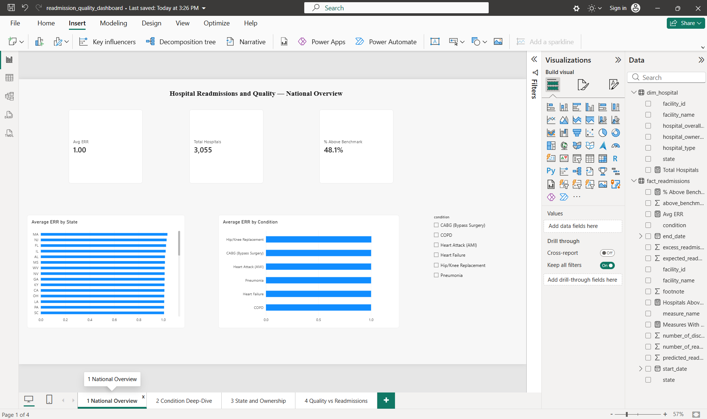
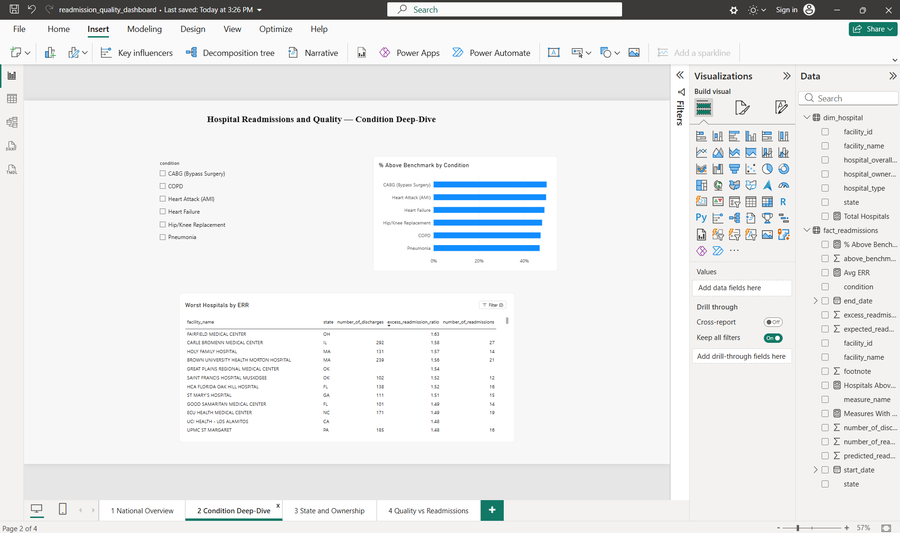
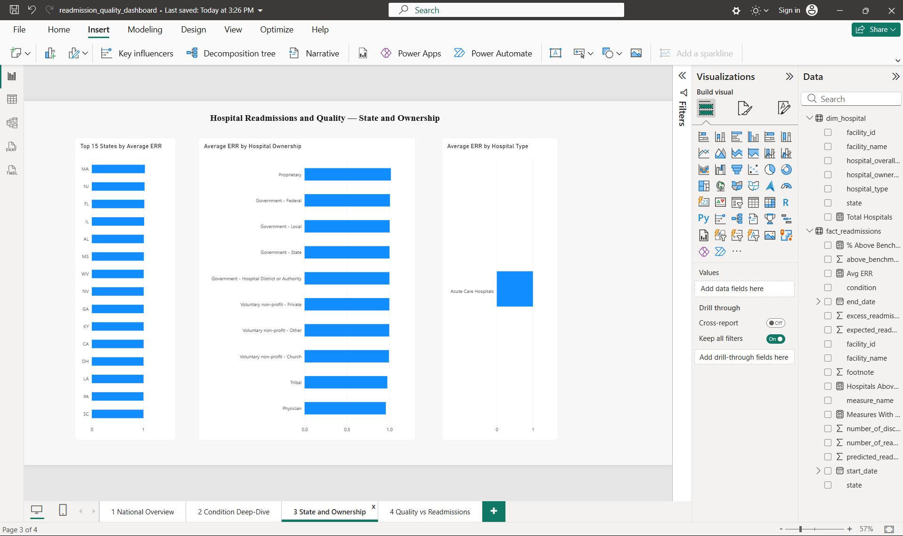
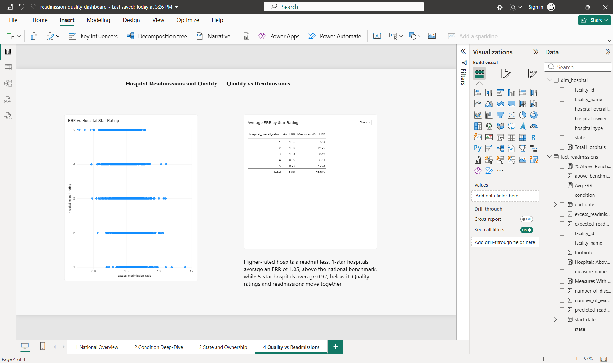
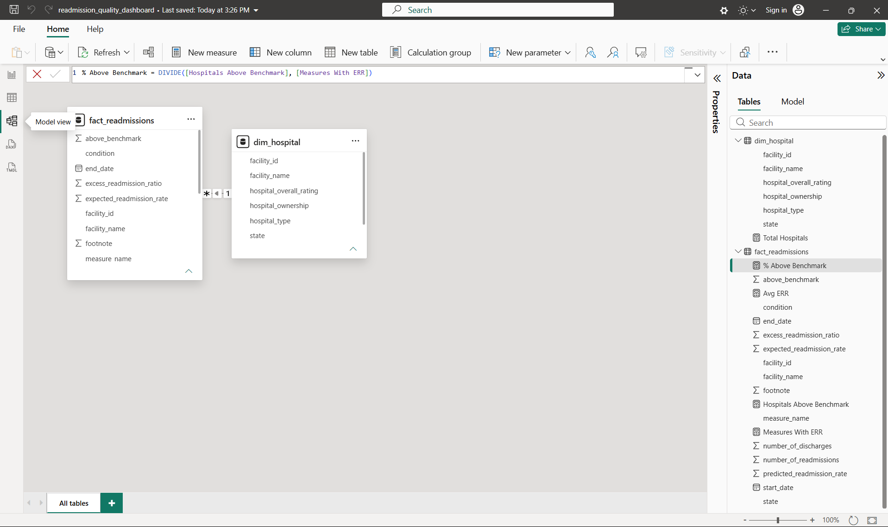

# Hospital Readmission and Quality Performance Analysis
CMS Hospital Readmissions Reduction Program (HRRP) - SQL, Python (Pandas), Power BI

## Business questions
Which conditions, hospitals and states readmit patients more often
than the national benchmark? Does hospital ownership or quality
rating go with readmissions? How complete is the data behind
each answer?

## Data
CMS Provider Data Catalog, FY2026 files. HRRP file: 18,330 rows -
3,055 hospitals x 6 conditions (Heart Failure, Pneumonia,
Heart Attack, COPD, Hip/Knee Replacement, CABG / Bypass Surgery).
Hospital General Information file: 5,435 hospitals.
Join key: Facility ID. Full notes: data_notes/data_dictionary.md

## Definitions (read before quoting any number)
- ERR (Excess Readmission Ratio) = predicted readmissions /
  expected readmissions. Above 1.0 = worse than the benchmark.
  Below 1.0 = better than the benchmark.
- Missing ERR is never zero. "Not Available", "N/A" and
  "Too Few to Report" mean CMS did not report a number.
  6,610 of 18,330 rows (36.0%) have no ERR.
- CABG rests on the smallest base: only 878 of 3,055 hospitals
  have a CABG ERR. Pneumonia rests on the largest: 2,715.
- 222 rows (1.2%, 37 hospitals) have no match in the hospital
  file, so they show blank hospital info in the dashboard.

## Headline results (all computed in sql/ and notebooks/)
- Hospitals in HRRP: 3,055  |  Hospital-measure rows: 18,330
  |  Rows with an ERR: 11,720
- Mean ERR is close to 1.0 for every condition:
  Hip/Knee Replacement 1.0040, CABG 1.0018,
  Heart Attack 1.0018, Pneumonia 1.0015,
  Heart Failure 1.0014, COPD 1.0011
- Share above benchmark: CABG 49.9% | Heart Attack 49.7%
  | Heart Failure 48.9% | Hip/Knee Replacement 47.9%
  | COPD 47.2% | Pneumonia 46.8%
- Worst states (100+ measures): MA 1.0344 (240 measures)
  | NJ 1.0277 (272 measures)
- Ownership: Proprietary worst 1.0171
  | Physician-owned best 0.9577
- Quality rating: 1-star hospitals 1.0484 | 2-star 1.0250
  | 3-star 1.0061 | 4-star 0.9855 | 5-star 0.9663 -
  higher-rated hospitals readmit less
- Worst single ERR: Fairfield Medical Center, OH,
  Hip/Knee Replacement 1.6297 (its discharge and
  readmission counts are hidden - "Too Few to Report")
- Best Pneumonia ERR: Augusta Health, VA 0.7967
- Window function (q11): top 3 Heart Failure hospitals
  in each state, 153 rows. Worst: Central Peninsula
  General Hospital, AK 1.2271

## Dashboard (4 pages)
1 National Overview

2 Condition Deep-Dive

3 State and Ownership

4 Quality vs Readmissions

## Data model

## How to reproduce
1. Download the FY2026 HRRP and Hospital General
   Information files (CMS Provider Data Catalog) into
   a Drive folder.
2. Run notebooks/01_data_cleaning.ipynb to build
   readmissions.db (fact_readmissions + dim_hospital).
3. Run the queries in sql/ in order q01-q11.
4. Run notebooks/02_exploratory_analysis.ipynb;
   compare with the SQL results.
5. Open the Power BI model (fact_readmissions joined
   to dim_hospital on facility_id).
